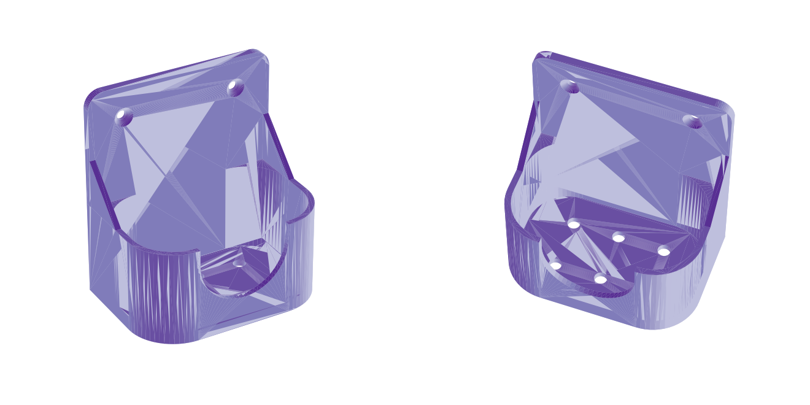

# Nástenný stojan na mydlo Dettol Soft on Skin 250 ml

| Súbor | Popis |
|---|---|
| `dettol_stojan.stl` | hotový model na slicovanie (90,6 × 59,8 × 100 mm) |
| `dettol_stojan.scad` | parametrický zdroj pre OpenSCAD – rozmery fľaše sa dajú upraviť |
| `generate_stl.py` | to isté v Pythone (`pip install manifold3d trimesh`) |

## Pred tlačou
Model počíta s pôdorysom fľaše **82 × 50 mm** a vôľou 1,5 mm na stranu.
Fľašu odmerajte posuvkou v spodnej časti; ak sa líši, upravte `flasa_sirka` /
`flasa_hlbka` v `.scad` (alebo v `generate_stl.py`) a vyexportujte STL znova.

## Nastavenia tlače (Ender 3 Pro, Cura)
- **Orientácia:** vzpriamene, ako na náhľade – dno košíka na podložke. Bez podpier.
- **Materiál:** PETG (do kúpeľne, odolá vlhkosti); PLA tiež pôjde.
- Výška vrstvy 0,2 mm, 4 perimetre (steny), výplň 20–25 % gyroid.
- Brim 5 mm odporúčaný (vysoká tenká doska).
- Čas cca 3–4 h, materiál cca 80–95 g.

## Montáž
- 2 skrutky Ø 4 mm so zápustnou hlavou + hmoždinky 6 mm (rozostup 56 mm).
- Alebo bez vŕtania: obojstranná montážna páska (napr. 3M VHB) na celú zadnú dosku.
- Otvory na dne odvádzajú vodu, predný výrez nechá vidieť etiketu a uľahčí vyberanie.
